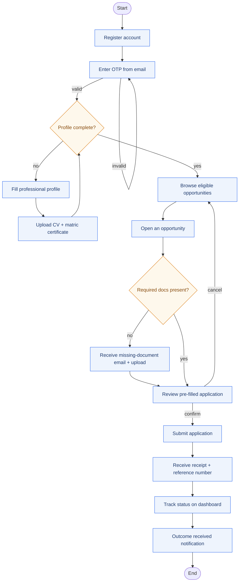
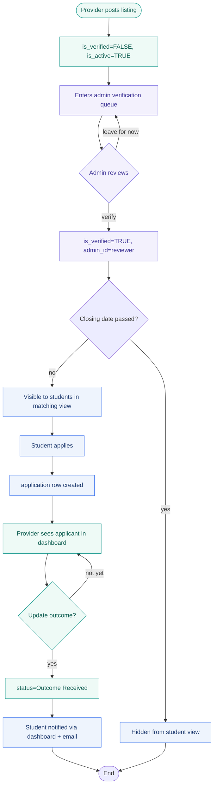

# Scout — Activity Diagrams

Two end-to-end workflows: the student's journey from signup to a submitted application, and the opportunity lifecycle from the moment a provider posts it to the moment a student sees an outcome.

---

## 1. Student application journey

Covers FR1 (register + verify), FR2 (eligibility matching), FR3 (assisted apply) and FR4 (missing document detection).

---

## 2. Opportunity lifecycle (provider + admin + student)

Covers FR9 (admin verification) and FR10 (provider listing management). Lanes are represented visually; Mermaid lacks native swim-lanes, so each role's step is labelled.

## Legend (lifecycle)

- **Teal** — provider actions
- **Purple** — admin actions
- **Blue** — student-facing effects
