# Scout — Application Architecture

A three-tier architecture: a React/Vite single-page frontend, a Django REST Framework backend, and a Supabase-hosted PostgreSQL database. External services (Brevo for SMTP, Supabase Storage for document files) are isolated behind backend-only adapters so the frontend never talks to them directly.

```mermaid
flowchart LR
    %% Users
    subgraph Users[Users]
        direction TB
        S_User(["👤 Student"])
        P_User(["🏢 Provider"])
        A_User(["🛡️ Administrator"])
    end

    %% Frontend
    subgraph Frontend[Frontend · React + Vite]
        direction TB
        Pages[Pages<br/>Login · Register · Eligible · Profile<br/>Apply · Dashboard · AdminVerify]
        Shared[Shared<br/>AuthContext · AuthLayout · AppShell · ProviderShell]
        ApiJS[lib/api.js<br/>fetch + Token header]
    end

    %% Backend
    subgraph Backend[Backend · Django + DRF]
        direction TB
        URLs[URL router<br/>/api/accounts/*<br/>/api/opportunities/*<br/>/api/applications/*<br/>/api/documents/*<br/>/api/notifications/*<br/>/api/providers-admin/*]
        Perms[core.permissions<br/>IsStudent · IsProvider · IsAdmin]
        Views[Views<br/>register · login · verify_otp · resend_otp<br/>provider_listings · applicants · outcomes<br/>pending_listings · verify_listing]
        OTP[accounts.otp_utils<br/>hash · verify · rate-limit]
        Storage[documents.supabase_storage<br/>upload · signed URL]
        Mail[django.core.mail<br/>SMTP backend]
    end

    %% Data & external services
    subgraph Data[Data & external services]
        direction TB
        DB[(Supabase PostgreSQL<br/>auth_user · student · provider · admin<br/>profile · opportunity · application<br/>bookmark · notification · login_otp)]
        Bucket[(Supabase Storage<br/>documents bucket)]
        SMTP[(Brevo SMTP<br/>smtp-relay.brevo.com:587)]
    end

    %% Flows
    S_User --> Pages
    P_User --> Pages
    A_User --> Pages
    Pages --> Shared
    Shared --> ApiJS
    ApiJS -- "HTTPS + Token" --> URLs
    URLs --> Perms --> Views
    Views --> OTP
    Views --> Storage
    Views --> Mail
    Views -- "ORM / managed=False" --> DB
    OTP --> DB
    Storage -- "signed-URL upload" --> Bucket
    Mail -- "SMTP 587 STARTTLS" --> SMTP

    classDef user fill:#fef8ec,stroke:#d97706,color:#8a4c0a;
    classDef fe fill:#eef4fd,stroke:#2563eb,color:#1e3a6f;
    classDef be fill:#eefaf6,stroke:#0d9488,color:#0f5f52;
    classDef data fill:#f3f1fd,stroke:#6f61e0,color:#3f3597;
    class S_User,P_User,A_User user;
    class Pages,Shared,ApiJS fe;
    class URLs,Perms,Views,OTP,Storage,Mail be;
    class DB,Bucket,SMTP data;
```

## Layer responsibilities

| Layer | Owns | Does not own |
|---|---|---|
| **Frontend** | Rendering, client-side validation, routing, token storage | Role decisions, OTP logic, business rules |
| **Backend** | Authentication, authorization, OTP issuance/verification, business rules, serialization, rate-limiting, email composition | Document storage internals, SMTP delivery mechanics |
| **Data & external services** | Durable storage, password hashing (auth_user), file hosting, email transport | Business rules |

## External service boundaries

- **Brevo SMTP** is reached through `django.core.mail` using environment-configured credentials (`EMAIL_HOST`, `EMAIL_HOST_USER`, `EMAIL_HOST_PASSWORD`). OTP codes are composed server-side and never exposed to the frontend. Switching providers is a `.env` change.
- **Supabase Storage** is reached through `documents.supabase_storage` using the service-role key held only on the server. The frontend receives signed URLs, never the key.
- **Supabase PostgreSQL** is accessed via the standard Django ORM. Scout's schema is hand-written in `database/schema.sql`; every model that maps to it declares `managed = False`. Django owns its own `auth_user`, `authtoken_token`, `django_session` tables.

## Deployment notes

- Frontend builds to static assets (`npm run build`) and can be served from any CDN or static host.
- Backend runs as a Django WSGI app; targets a single instance for dev and horizontal scale-out behind a load balancer for production.
- The database connection uses Supabase's pooled endpoint (`aws-1-eu-north-1.pooler.supabase.com:5432`) with SSL required.
