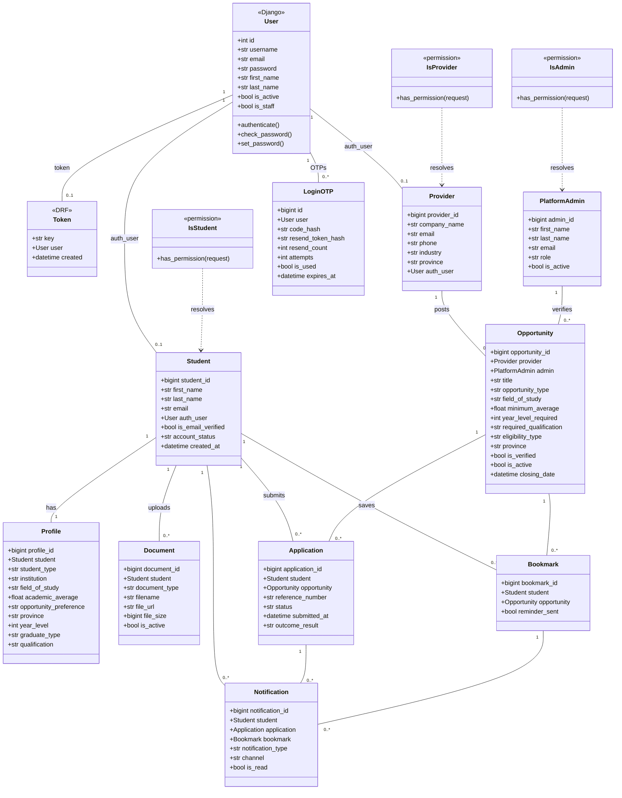

# Scout — Class Diagram

Django models that back Scout's API. All Scout models declare `managed = False` because the schema lives in `database/schema.sql`; Django only owns its own auth tables. Views in each app (`accounts`, `opportunities`, `applications`, `documents`, `notifications`, `providers_admin`) consume these models through serializers.

## Notes

- `User` is the Django `auth.User` model. `is_staff=True` plus a matching `PlatformAdmin` row by email is the signal that identifies an administrator.
- `PlatformAdmin` is deliberately named to avoid collision with `django.contrib.admin`.
- `IsStudent`, `IsProvider` and `IsAdmin` DRF permission classes attach the resolved role row to the request (`request.student`, `request.provider`, `request.admin`) so views never re-query.
- The `student.password_hash` legacy column is nullable and unused; Django's `auth_user.password` is the real credential store.
