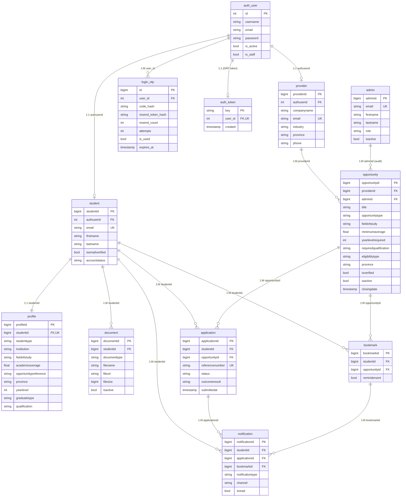

# Scout — Entity Relationship Diagram

The complete data model. Django's own `auth_user` and `auth_token` tables sit alongside Scout's application tables; the two sides meet through `student.authuserid`, `provider.authuserid` and `login_otp.user_id`.

## Cardinality notes

- `student ||--|| profile` — every active student is expected to have a profile; the `1:1` constraint is enforced by the `UNIQUE (studentid)` on `profile`.
- `admin ||--o{ opportunity` is an *audit* relationship: `opportunity.adminid` records which administrator verified the listing, not who owns it.
- `notification` references either an application OR a bookmark, never both (CHECK constraint `chk_notification_reference`).
- The `auth_user.is_staff` flag, combined with a matching email in the `admin` table, resolves the administrator role.
