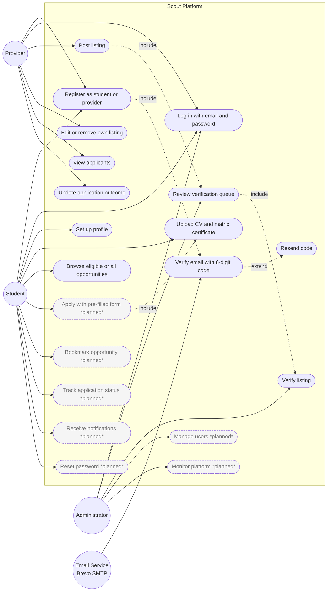
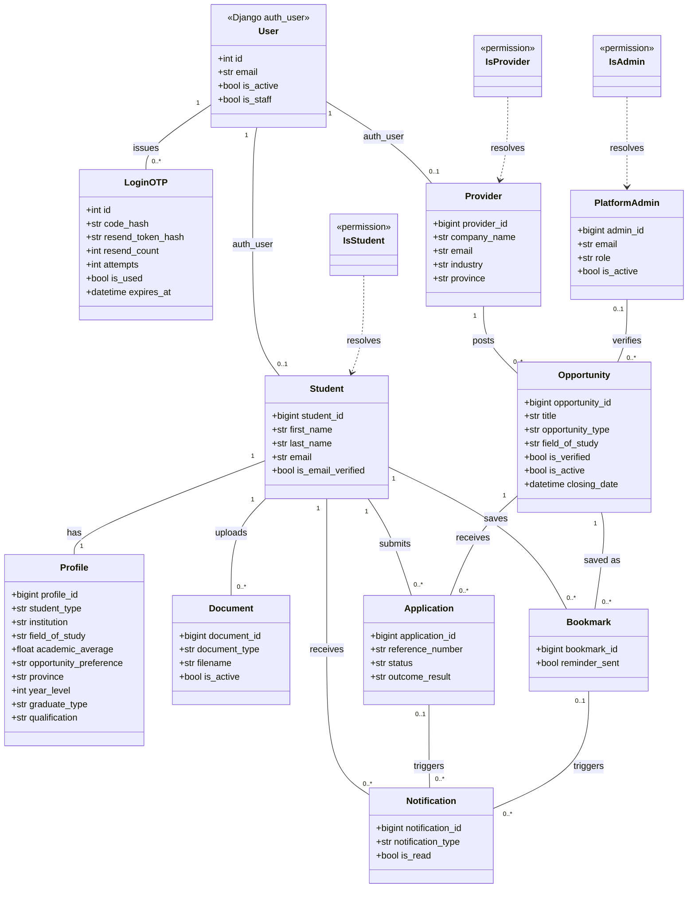
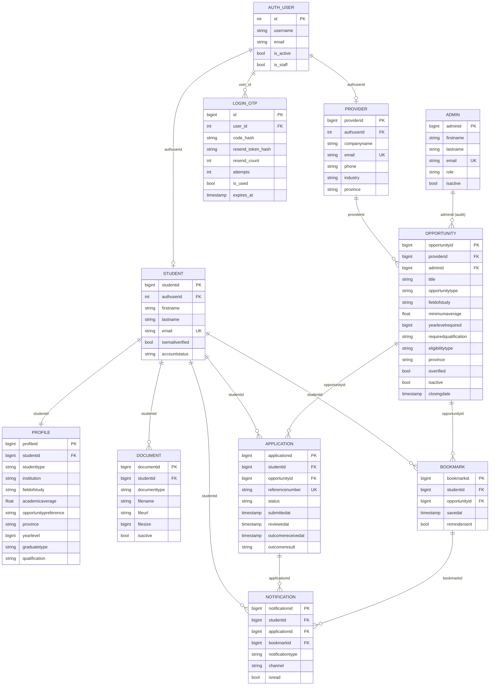
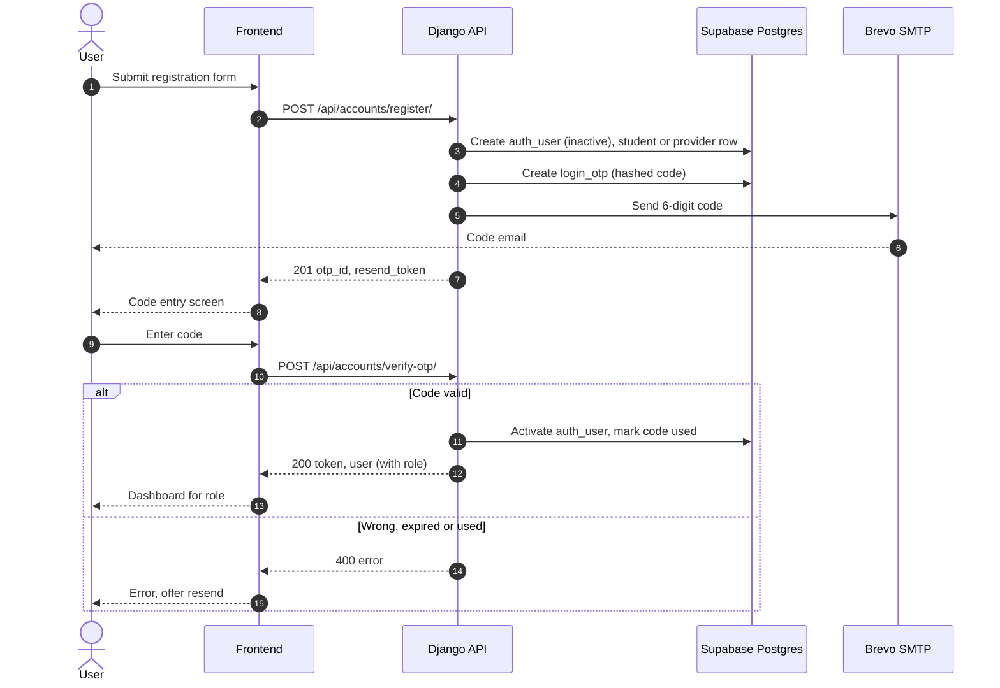
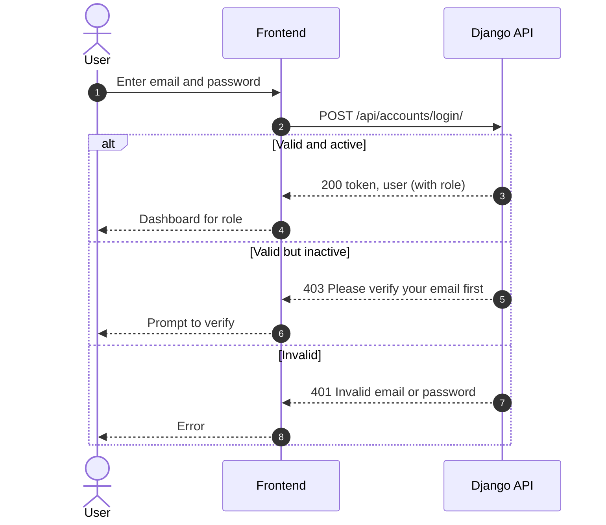
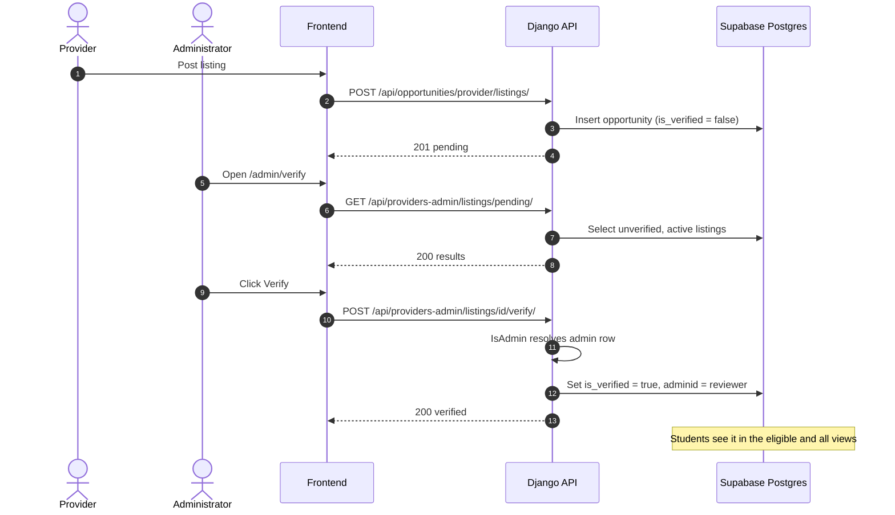
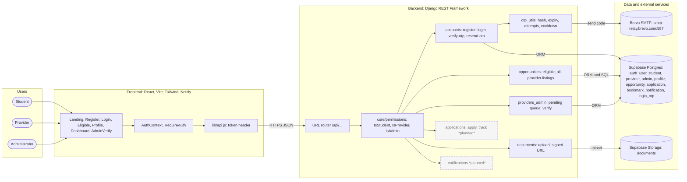

# Scout: Revised Diagram Reference

Written for: group members revising the existing PDF and drawio diagrams.

How to use: for each diagram, read the change overview, then copy the Mermaid block. Mermaid renders in GitHub, VS Code (with a Mermaid extension) and mermaid.live. Items marked *(planned)* are designed but not built. Draw them dashed or grey, and label them planned.

---

## 1. Use case diagram

**What changed**
- Email verification is now a 6-digit code entered in the app (no link).
- Login is email and password only. There is no OTP on login.
- Providers have their own sign-up and login. Providers post listings, which wait for admin approval.
- Admins log in and verify listings from a queue. Verification is recorded against the admin.
- Reset password, user management, monitoring, and the apply, track and notification features are planned, not built.

---

## 2. Class diagram

**What changed**
- `Admin` is now `PlatformAdmin`, linked to a Django user by email with `is_staff`.
- `LoginOTP` added: stores hashed codes, attempt count and expiry.
- Permission classes added: `IsStudent`, `IsProvider`, `IsAdmin`.
- `Provider` is linked to a Django user, the same as `Student`.
- The matching logic lives in `matching.py`, not in a separate eligibility file.
- Removed the generic `User.Register()` and `Logout()` methods. Those are view functions now.

---

## 3. Entity relationship diagram

**What changed**
- Added `login_otp` and `provider.authuserid`.
- Corrected column names: `reviewedat` and `outcomereceivedat` replace `ReceivedAt`. `minimumaverage` replaces the misspelling.
- Added `requiredqualification` to opportunity, and `studenttype`, `graduatetype` and `qualification` to profile.
- `Student.PasswordHash` is marked legacy (unused).

---

## 4. Activity diagram

**What changed**
- Registration now ends in a code entry step. The account activates on a correct code, and the user is logged in.
- Login has no code step. Unverified accounts see a message to verify first.
- Provider and admin flows are added as their own paths.
- Auto-apply, missing-document alerts and the summary download are marked planned.

```mermaid
flowchart TD
    subgraph Student
        S0([Start]) --> S1[Choose Register as student]
        S1 --> S2[Enter name, email, password]
        S2 --> S3{Details valid?}
        S3 -->|no| S2
        S3 -->|yes| S4[Account created, 6-digit code emailed]
        S4 --> S5[Enter code]
        S5 -->|wrong or expired| S6[Show error, resend code]
        S6 --> S5
        S5 -->|correct| S7[Account activated and logged in]
        S7 --> S8[Build profile and upload CV and matric]
        S8 --> S9[Browse eligible opportunities]
        S9 --> S10{Apply now?}
        S10 -->|no| S9
        S10 -->|yes| S11[Review pre-filled form *planned*]
        S11 --> S12[Submit, reference number issued *planned*]
        S12 --> E1([End])
    end

    subgraph Returning_user [Returning user]
        R1([Open Log in]) --> R2[Enter email and password]
        R2 --> R3{Credentials valid?}
        R3 -->|wrong| R4[Show invalid email or password]
        R4 --> R2
        R3 -->|valid but unverified| R5[Prompt to verify email first]
        R3 -->|valid and verified| R6[Token issued, open dashboard]
        R6 --> E2([End])
    end

    subgraph Provider
        P1([Register as provider]) --> P2[Enter company, industry, province]
        P2 --> P3[Enter code, account activated]
        P3 --> P4[Post listing]
        P4 --> P5[Listing pending admin approval]
        P5 --> P6[View applicants, update outcome]
        P6 --> E3([End])
    end

    subgraph Admin
        A1([Log in with admin account]) --> A2[Open verification queue]
        A2 --> A3{Verify listing?}
        A3 -->|yes| A4[Listing verified, admin recorded]
        A3 -->|no| A2
        A4 --> A5[Listing visible to students]
        A5 --> E4([End])
    end
```

---

## 5. Sequence diagrams

### 5a. Sign-up with email code

**What changed:** a 6-digit code replaces the verification link, and the code step activates the account.

### 5b. Login (no code)

**What changed:** login is one step. Unverified accounts are told to verify first.

### 5c. Admin verifies a listing

**What changed:** added the admin queue and the audit field.

---

## 6. Application architecture

**What changed**
- Brevo SMTP added as an external service.
- OTP flow and login added in the accounts app.
- Admin endpoints and the permission layer added.
- Frontend pages updated to the current set.
- Applications and notifications marked planned where not complete.

---

## Checklist before handing back

- Each diagram uses the same names as `docs/Diagram Revision Brief.md`.
- Planned items are dashed or greyed and labelled planned.
- No em dashes in text.
- The FR numbers on the use case diagram match the agreed numbering.
