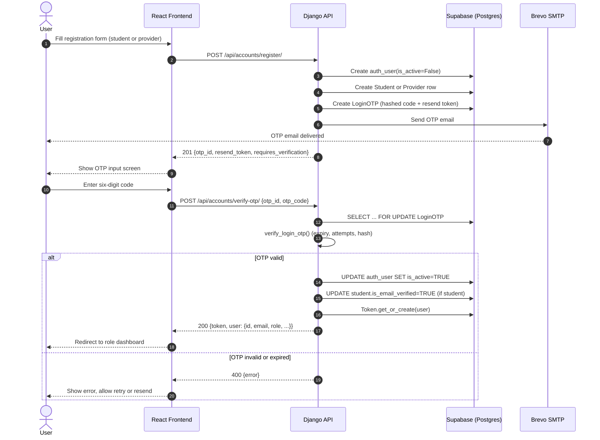
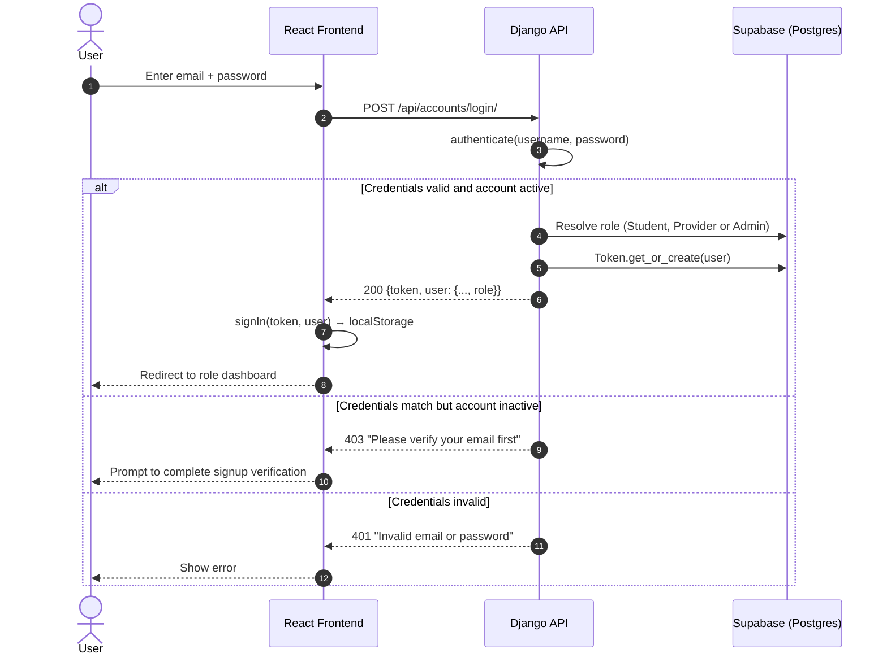

# Scout — Sequence Diagrams

Three flows that are central to the current build: signup with OTP verification, subsequent login, and the admin verification of a provider listing.

---

## 1. Signup & email verification

New users register and verify their email before gaining access. The `auth_user` row is created inactive (`is_active=False`) and only activated after the correct OTP is submitted.



---

## 2. Login (after verification)

Login is a single step — credentials in, token out. Inactive users (unverified email) are intercepted with a specific message rather than a generic "invalid credentials".



---

## 3. Admin verifies a pending listing (FR9)

A provider posts a listing; it is created with `is_verified=False` and is invisible to students until an admin approves it through the admin dashboard. The reviewing admin's `admin_id` is written to the opportunity row as an audit trail.

```mermaid
sequenceDiagram
    autonumber
    actor P as Provider
    actor A as Administrator
    participant FE as Frontend
    participant BE as Django API
    participant DB as Supabase (Postgres)

    P->>FE: Post opportunity form
    FE->>BE: POST /api/opportunities/provider/listings/
    BE->>DB: INSERT opportunity (is_verified=FALSE, is_active=TRUE)
    BE-->>FE: 201 listing created (pending)

    Note over A,FE: Later — admin opens the queue
    A->>FE: Open /admin/verify
    FE->>BE: GET /api/providers-admin/listings/pending/
    BE->>DB: SELECT opportunity WHERE is_verified=FALSE AND is_active=TRUE
    BE-->>FE: 200 {results: [...]}
    FE-->>A: Render queue; admin clicks one for details

    A->>FE: Click "Verify"
    FE->>BE: POST /api/providers-admin/listings/{id}/verify/
    BE->>BE: IsAdmin.has_permission(request) → load request.admin
    BE->>DB: UPDATE opportunity SET is_verified=TRUE, admin_id=request.admin.admin_id
    BE-->>FE: 200 {message, opportunity_id, verified_at}
    FE-->>A: Toast; listing disappears from queue

    Note over DB: Students now see the listing in /api/opportunities/?view=eligible
```
