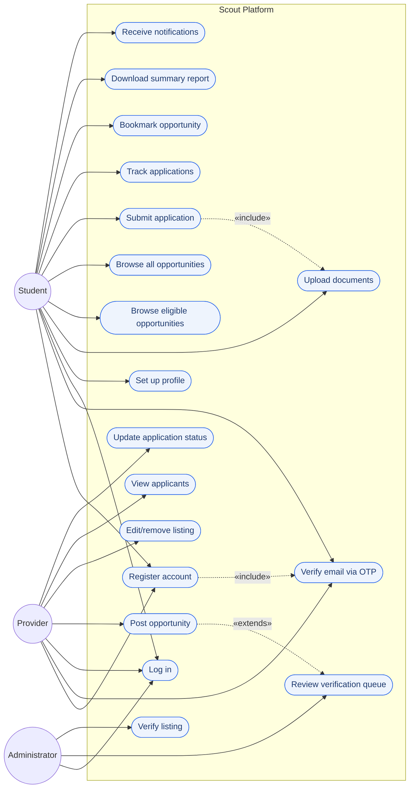

# Scout — Use Case Diagram

Three actors interact with the system: **Student**, **Provider** and **Administrator**. Mermaid's flowchart syntax is used in the style of a UML use case diagram — actors on the sides, use cases as rounded shapes inside the system boundary. Shared use cases (registration, email verification, authentication) sit at the top.

## Actor summary

| Actor | Scope |
|---|---|
| **Student** | Owns a profile and documents, browses and applies for opportunities, tracks outcomes, receives notifications. |
| **Provider** | Posts opportunities, reviews applicants, updates application outcomes. Every new listing enters the admin queue. |
| **Administrator** | Reviews pending listings in the verification queue; approving one makes it visible to students. Identity is recorded against the opportunity row as an audit trail (FR9). |

## Include / extend

- **`Register` «includes» `Verify email via OTP`** — a registration is only complete after OTP verification.
- **`Submit application` «includes» `Upload documents`** — if required documents are missing, the student is routed to document upload (FR4) before the review screen appears.
- **`Post opportunity` «extends» `Review verification queue`** — every newly posted listing extends into the admin queue automatically; the provider does not interact with the queue directly.
